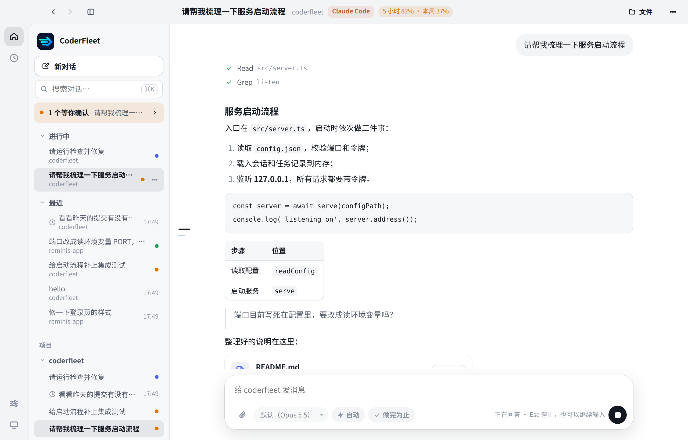
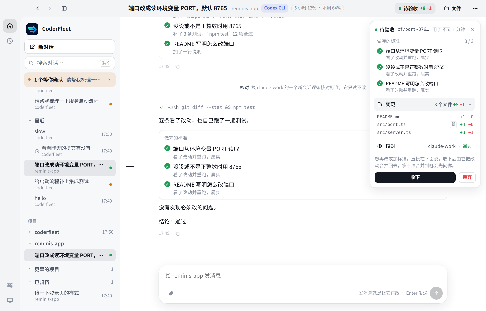
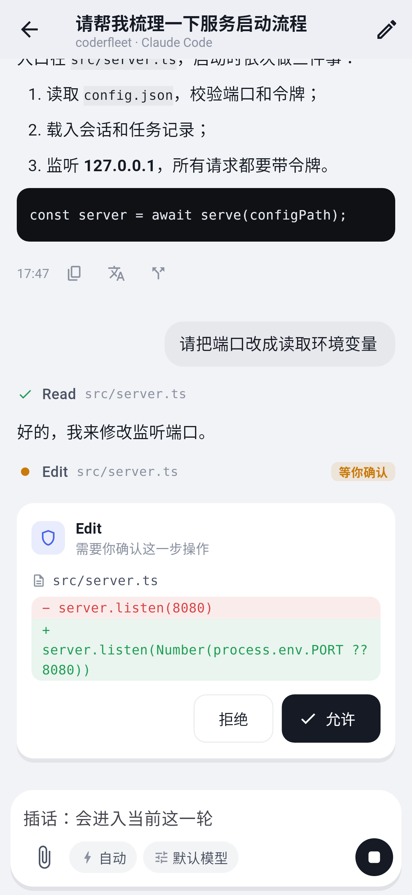

# CoderFleet

> 把多个 Codex CLI / Claude Code / OpenCode / Hermes Agent / Grok Build / Kimi Code 账号变成一支可调度的 AI 开发舰队。

[](https://github.com/zhchxiao123/coderfleet/actions/workflows/app.yml)
[](https://github.com/zhchxiao123/coderfleet/releases/latest)

**[使用文档](https://zhchxiao123.github.io/coderfleet/)** · [下载](https://github.com/zhchxiao123/coderfleet/releases/latest)

CoderFleet 是面向 AI 编程重度用户的多账号开发工作台：在一台机器上同时运行多个 AI 编程账号，每个账号有独立的容器、认证文件和代理出口。

**现在推荐使用桌面 App。** 账号登录、项目与容器、镜像、代理、终端和对话都在 App 里完成，不需要记命令；手机 App 可以随时接着聊、批准操作。



| 交付与验收 | 手机上批准操作 |
| --- | --- |
|  |  |

## 适合谁？

- 同时使用多个 Codex / Claude Code / OpenCode / Grok Build / Kimi Code 账号的开发者
- 经常遇到单账号额度限制的 AI 编程重度用户
- 希望多个 AI Agent 并行处理任务的独立开发者
- 需要本地容器隔离、代理隔离和账号隔离的用户

## 核心能力

- 多账号：Claude Code / Codex / OpenCode / Hermes Agent / Grok Build / Kimi Code / Antigravity / Pi，每个账号独立容器
- 每个项目绑定一个账号，在项目里直接对话；工具调用需要确认时在 App 里批准
- 交付验收：改动在独立分支里完成，看过差异和核对结果后再收下
- 定时任务、文件预览、容器终端、订阅额度一眼可见
- 远程 Docker 主机：填 `user@host`，App 通过 SSH 装好后端并建立隧道，远端不开端口
- 手机 App（iOS / Android）：扫码配对，只能聊天、可随时吊销
- 宿主机代理中继，统一管理网络出口

## 下载

在 [Releases](https://github.com/zhchxiao123/coderfleet/releases/latest) 下载对应平台的安装包：

| 平台 | 文件 | 安装 |
| --- | --- | --- |
| macOS（Apple 芯片 / Intel） | `CoderFleet-<版本>-mac-arm64.dmg` / `-mac-x64.dmg` | 打开后把 CoderFleet 拖进「应用程序」 |
| Windows | `CoderFleet-<版本>-windows-x64-setup.exe` / `-windows-arm64-setup.exe` | 双击安装，不需要管理员权限 |
| Linux（Debian / Ubuntu） | `CoderFleet-<版本>-linux-amd64.deb` / `-linux-arm64.deb` | `sudo apt install ./CoderFleet-*.deb` |
| Linux（其他发行版） | `CoderFleet-<版本>-linux-x64.tar.gz` / `-linux-arm64.tar.gz` | 解压后运行里面的 `CoderFleet` |
| Android | `CoderFleet-<版本>-android.apk` | 直接安装 |
| iOS | 暂无安装包 | 用 Xcode 自行编译（见 [mobile/README.md](mobile/README.md)） |

目前主要在 macOS 上验证；Windows 和 Linux 包是自动构建的产物，尚未充分测试。每次提交到 `main` 的最新构建在 [Actions → Build apps](https://github.com/zhchxiao123/coderfleet/actions/workflows/app.yml) 的 Artifacts 里。

> 安装包目前没有开发者签名。macOS 首次打开若提示无法验证，执行 `xattr -dr com.apple.quarantine /Applications/CoderFleet.app` 后再打开；Windows 在 SmartScreen 提示里选「仍要运行」。

## 快速开始（桌面 App）

需要：Docker Desktop（macOS / Windows）或 Docker Engine + Compose V2（Linux）；容器要走代理时，宿主机上运行 Clash / v2ray 等并开启 allow-lan。

1. 打开 App，选择「这台电脑」，点 **初始化工作区**（默认在 `~/.coderfleet`）。
2. 构建镜像（首次约 5–10 分钟）。
3. 添加账号并登录，添加项目并选择它使用的账号。
4. 在项目里开始对话。

Docker 在另一台机器上时，在「设置 → 后端连接 → 通过 SSH 添加」填 `user@host`。架构、远程主机和开发说明见 [node-app/README.md](node-app/README.md)。

### 手机 App

在桌面 App 的「设置 → 手机访问」里点「添加手机」，用手机 App 扫二维码。同一局域网、ZeroTier / WireGuard / Tailscale 组网或内网穿透地址都可以，详见 [mobile/README.md](mobile/README.md)。

### 从源码运行

```bash
# 桌面 App（Node.js 22.18+）
cd node-app && npm ci && npm test && npm run desktop
npm run package            # 打包当前平台，产物在 out/

# 手机 App（Flutter 3.50+）
cd mobile && flutter pub get && flutter test && flutter run
```

### 发布新版本

```bash
scripts/release.sh 0.2.1
```

规则见 [RELEASING.md](RELEASING.md)。[app.yml](.github/workflows/app.yml) 会测试并构建全部平台，然后创建带安装包的 GitHub Release。
