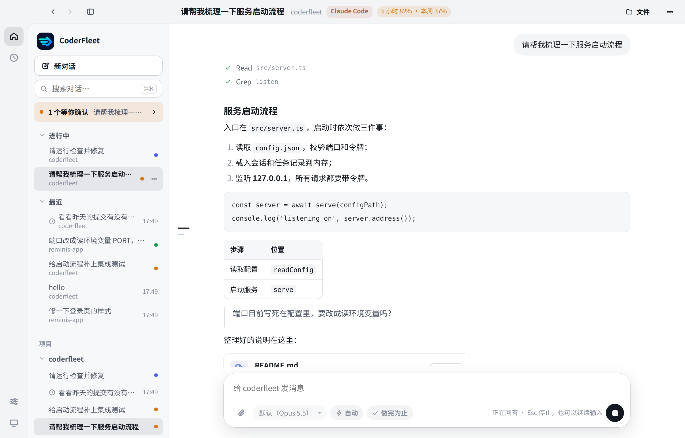

# 对话

## 开始一个对话

点「新对话」（或某个项目菜单里的「新对话」），在输入框旁选择项目，输入要做的事，按 Enter 发送。Shift+Enter 换行。

只有新对话能换项目；对话开始后就固定在这个项目和它的账号上。

侧边栏里的对话分为「进行中」「最近」和按项目分组；⌘K（Ctrl+K）搜索对话。有对话在等你时，侧边栏顶部显示「N 个等你确认」，点一下跳过去。

## 输入栏

- **附件**：点回形针，或直接粘贴、拖进来。图片、PDF 和任意文件都可以，单个最大 500 MB，一次最多 20 个。
- **模型**：Claude Code 和 Antigravity 账号可以选模型，其他类型用 CLI 自己的默认模型。
- **自动**：打开后不再逐个询问工具调用。Claude 跳过权限确认，Codex 不再限制在工作区内，其他账号自动批准。这个开关按项目记住。
- **做完为止**：见 [做完为止](jobs.md)。

## 审批和提问

没开「自动」时，AI 要运行命令、修改或写入文件会出现审批卡，点「允许」或「拒绝」。

AI 需要你做选择时会出现提问卡，选好或填写后点「提交回答」，它接着往下做。

后端重启不会丢失进行中的回答和待审批的请求；已经发出的消息也不会被重复执行。

## 回答进行中

- 输入框为空时，发送按钮变成「中断」（Esc）。
- 这时再发消息：Claude Code 会把它**插入**当前这一轮；其他类型会**排队**，等这轮结束后再发，最多排 5 条，可以点「不发了」取消。

## 回答下方的操作

- **复制**
- **翻译成中文 / 显示原文**：需要先在「设置 → 通用 → 翻译与命名」里配置一个模型。
- **从这里分叉**：从这条回答开一个新对话，之前的上下文带过去。只有已完成的 Claude Code 回答可以分叉。项目文件是共享的，分叉不会回滚代码。

## 文件

对话页的「文件」面板可以浏览项目目录、预览文本文件（只显示前 512 KB）、复制路径，或把文件保存到本机（最大 50 MB）。

AI 发给你的文件会在回答里显示成卡片，可以预览或下载。

## 管理对话

对话的更多菜单里有「重命名」「重新生成标题」「归档」「删除」「打开项目终端」「查看项目」。

- 标题默认取第一条消息的开头；配置了「翻译与命名」的模型后会自动起标题。
- 归档的对话收进「已归档」，再发消息会自动恢复。
- 删除后不能恢复，但项目文件不受影响。回答还在进行、或「做完为止」还没收下或丢弃时不能删除。

## 翻译与命名

「设置 → 通用 → 翻译与命名」里配置一个单独的模型，用来翻译回答和给对话起标题，不占用项目账号的额度。

| 字段 | 说明 |
| --- | --- |
| 接口类型 | `anthropic` 或 `openai`；OpenAI 兼容接口也选 `openai` |
| 模型 | 模型名 |
| API Key | 只保存在工作区的 `config.conf` 里，保存后不再显示 |
| Base URL | 可选，用于兼容接口或中转 |
| 出站代理 | 可选 |
