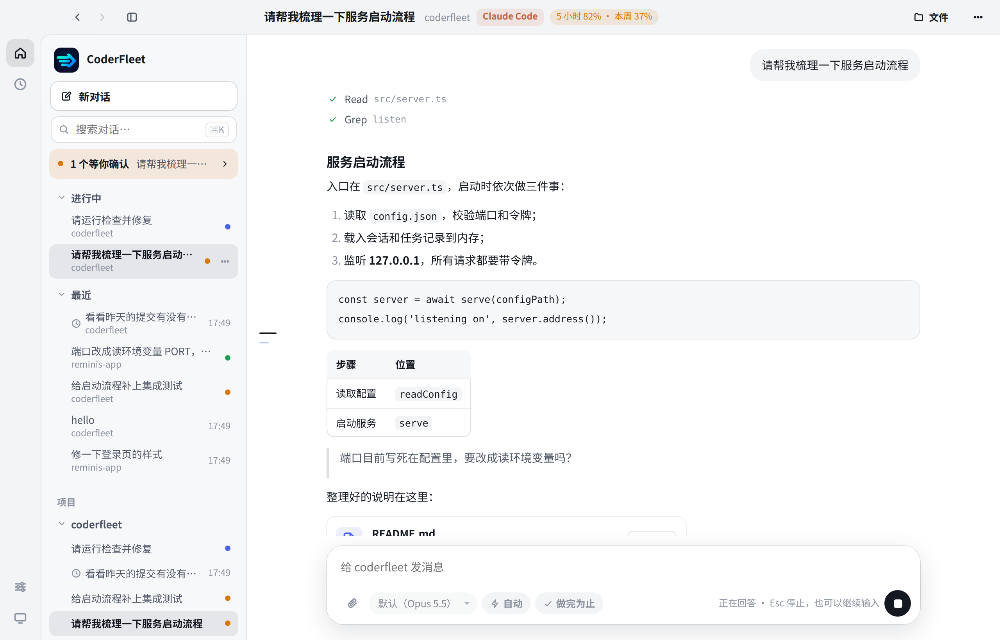

# CoderFleet

把多个 AI 编程账号（Claude Code、Codex、Antigravity、OpenCode 等）放进各自的 Docker 容器里，在一个桌面 App 里和它们对话、审批、验收，把几个账号的额度合起来用。

## 它做什么

- **每个账号一个容器。** 登录数据只挂载到这个账号自己的容器里，账号之间互不可见。
- **统一出口。** 容器默认只能经一个代理中继访问外网，流量都走你宿主机上的代理。
- **在 App 里完成全部操作。** 添加账号和登录、建项目、准备镜像、对话、批准工具调用、看文件、开终端。
- **做完为止。** 让 AI 在独立分支上把一件事做到满足它自己列出的标准，另一个账号核对后再交给你收下或丢弃。
- **定时。** 到点自己开一个新对话去做事。
- **手机。** iOS / Android App 扫码配对，只能聊天，随时可以吊销。
- **远程机器。** Docker 在另一台 Linux 上时，填 `user@host`，App 通过 SSH 装好后端并建立隧道。

## 从哪里开始

1. [安装](install.md) 桌面 App。
2. 跟着 [第一次使用](quickstart.md) 初始化工作区、下载镜像、添加账号和项目。
3. 读 [对话](chat.md)，了解审批、插话和附件。

## 支持的账号类型

| 类型 | 登录方式 |
| --- | --- |
| Claude Code | 登录账号，或 API Key |
| Codex CLI | 只支持登录账号 |
| Antigravity CLI | 登录账号，或 API Key |
| OpenCode | 登录账号，或 API Key |
| Hermes Agent | 登录账号，或 API Key |
| Grok Build | 登录账号，或 API Key |
| Kimi Code | 登录账号，或 API Key |
| Pi Agent | 登录账号，或 API Key |
