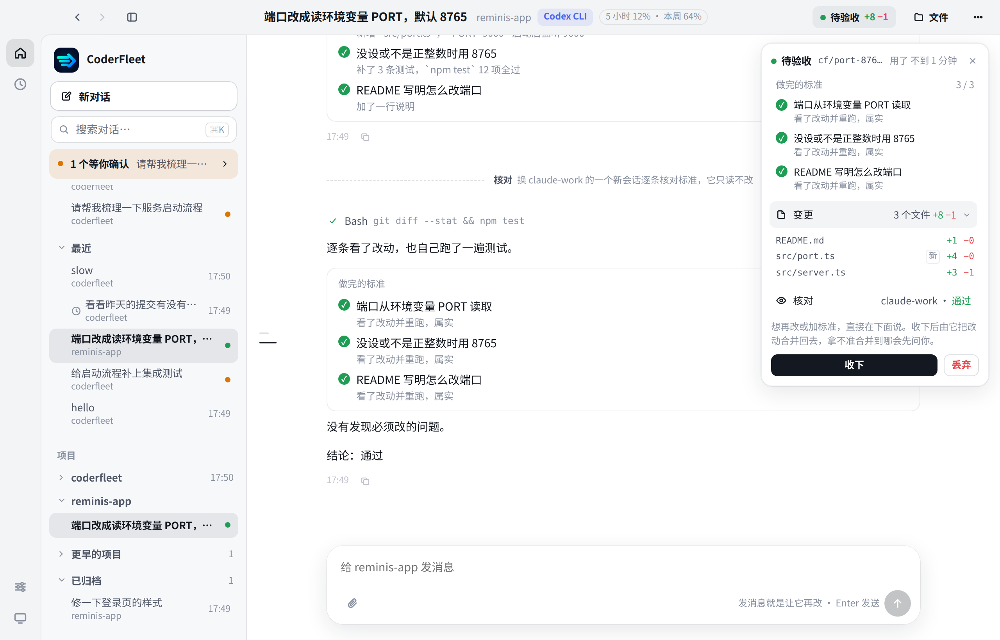

# 做完为止

普通对话里，AI 回答完就停。打开「做完为止」后，它会在一个独立分支上把这件事做到满足标准，核对过再交给你决定收不收。

## 使用条件

- 账号是 Claude Code 或 Codex。
- 项目目录是一个 git 仓库的根目录，并且至少有一次提交。
- 项目容器在运行。

不满足时，输入栏会提示「做完为止用不了」和原因。

## 过程

1. **开工。** App 新建一个 `cf/` 开头的分支和一个单独的工作目录，AI 在那里做，不动你的主目录。主目录里还没提交的改动不会带过去。这期间工具调用自动执行，不再逐个问你。
2. **列标准。** AI 先写出「做完的标准」清单。每条会被标成做到了、还没做到，或者要你来定。
3. **接着做。** 还有标准没做到时，App 让它继续，最多 3 轮。
4. **核对。** 全部做到后，另开一个只读的会话逐条核对，给出「通过」或「要改」。同一个目录下如果还有另一个账号的项目，核对用那个账号；没有就用同一个账号。
5. **交给你。** 进度卡变成「待验收」，可以展开看改了哪些文件。

## 收下或丢弃

- **收下**：AI 把分支合并回去，拿不准合并到哪个分支时会先问你。确认合并后，分支和工作目录自动删除。
- **丢弃**：分支和工作目录被删除，不能恢复。对话保留。

结束后这个对话还能继续聊，也可以再开下一件事。

## 进度卡上的状态

| 状态 | 含义 |
| --- | --- |
| 在做 | AI 正在做或正在补没做到的标准 |
| 核对中 | 另一个会话在逐条核对 |
| 等你 | 有标准需要你来定，或者它问了问题 |
| 待验收 | 做完并核对过，等你收下或丢弃 |
| 已收下 / 已丢弃 | 已结束 |
