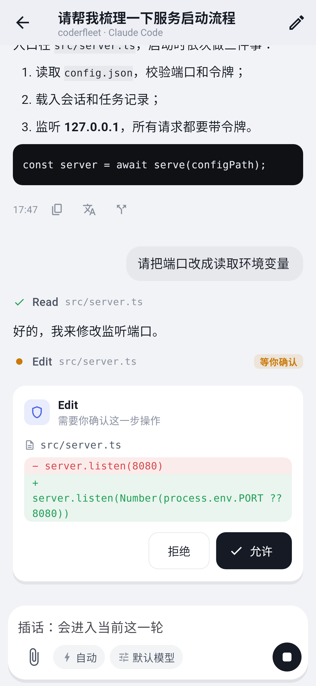

# 手机 App

手机 App 只做聊天：看对话、发消息、批准工具调用、回答提问。项目、账号、终端和设置仍在电脑上管理。

{ width="320" }

## 让手机连得上电脑

在桌面 App 的「通用 → 手机访问」里选一种方式：

- **同一个 Wi-Fi**：打开「允许局域网访问」。这种方式传输不加密，只在可信的网络里用。
- **组网工具**：ZeroTier / WireGuard 打开局域网访问后地址会自动出现；Tailscale 按界面提示把 `https://<机器>.ts.net` 加进地址列表。
- **内网穿透**：把 frp、Cloudflare Tunnel 或 ngrok 提供的 `https://` 地址加进去。

公网地址必须是 `https://`；`http://` 只允许局域网和组网地址。

## 配对

1. 电脑上点「添加手机」，填一个手机名称，点「生成二维码」。
2. 手机 App 里点「扫码连接」。扫不了的话，电脑上点「复制配对链接」，在手机上选「粘贴配对链接」。

二维码关掉后不会再显示，需要的话重新生成。手机拿到的是一个只能聊天的设备令牌，手机会按顺序尝试列表里的地址，用第一个连得上的。

手机丢了或不再使用时，在同一处点「吊销」。

## 手机上能做的

- 对话列表、搜索、新对话
- 发消息，附件可以拍照、从相册选或选文件
- 选模型、「自动」开关、中断、插话和排队
- 批准或拒绝工具调用、回答提问
- 复制、翻译、分叉、重命名

归档、删除、做完为止和定时目前只能在电脑上操作。

## 通知

App 在后台时，有对话等你批准或回答、完成或失败会弹通知。这是手机本地的通知，只在系统还让 App 运行时有效：Android 通常能持续一段时间；iOS 进后台几十秒后会挂起 App，锁屏久了收不到。
