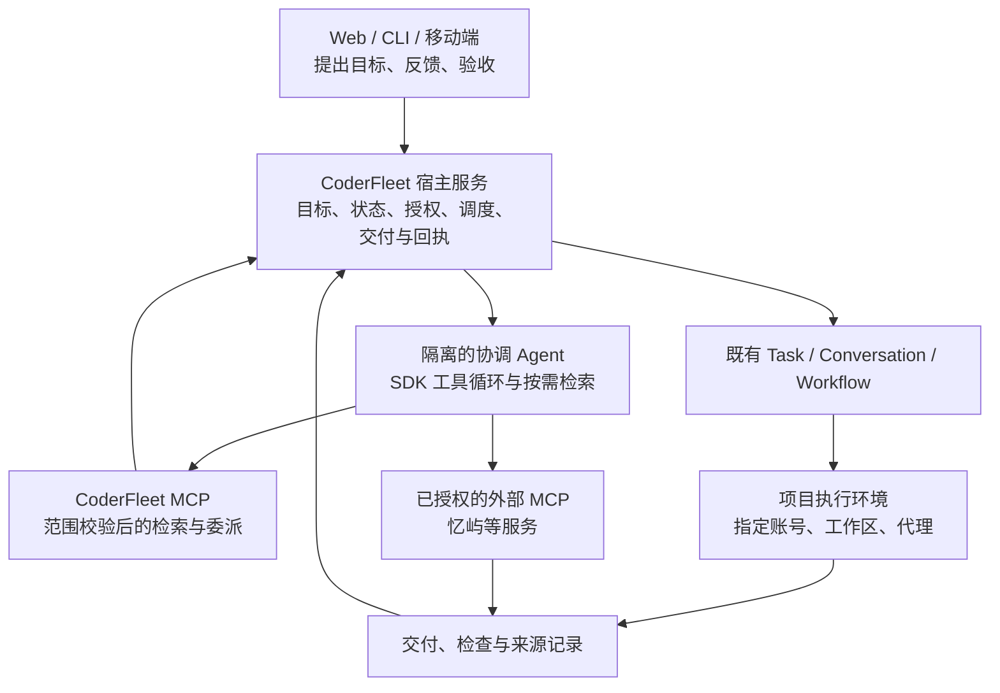

# CoderFleet 整体产品改造分析

日期：2026-11-15。范围：产品定位、用户工作流程、信息架构、Agent harness、实施顺序与验收。本文是改造建议，不是已批准 PRD，也不表示下述能力已经实现。

分析基于当前工作区源码、现有概念地图、SDK 覆盖记录、这段对话中的实际问题，以及本轮核验的官方资料。当前 HEAD 为 `65edea71b83018e0fc3d6fd09b22ab3553a2cb67`，工作区有既有未提交修改；分析参考当前文件，不覆盖这些修改。本轮未访问用户聊天库、调用真实模型或执行安装，不是运行时质量审计。

配套资料：[可浏览的产品蓝图](coderfleet-product-blueprint-20261115.html)、[官方能力与产品责任研究](coderfleet-agent-product-primary-sources-2026-11.md)。

## 已确认的改造约束：项目问答是基础

用户认可整体改造方向，并明确要求保留原来的项目问答。后续设计与实施必须遵守：

- **“AI 对话”保留为主导航中的默认入口。** 选择项目后可以直接新建对话、提问和连续追问，也可以继续通过对话进行开发。
- **问答无需先创建工作卡片、规划工作流或填写验收表。** 原型中的“工作详情”用于增强较复杂的委托，不成为所有对话的前置步骤。
- 保留项目切换、历史会话、原生上下文续聊、附件、流式 Markdown、执行过程，以及对应后端已支持的插话、中断、原生提问和排队能力。
- 项目 Agent 继续使用对应项目的工作目录、规则、账号与工具。平台助手负责可选的跨项目查询与协调，不接管或替代项目问答。
- 可以从已有对话关联工作与交付，沿用 Conversation、Task 和 session 归属，不通过复制对话或新建上下文强制迁移用户。
- **先验收项目问答不退化，再交付新增的工作管理能力。** 普通问答不要求人工验收后才能继续追问。

默认路径是“选项目 → 直接对话”；较复杂的委托可以沿原对话逐步增加目标、交付和验收视图。

## 1. 核心判断

**建议把 CoderFleet 从“多账号 AI CLI 调度工作台”，演进成“面向多项目工作的 Agent 开发工作台”。用户围绕目标、进展、需要自己处理的事项和交付物工作。现有账号、容器、代理和调度继续提供执行基础。**

这是对现有产品定位的扩展建议。仓库目前明确的 North Star 是通过账号池突破单账号容量限制，并保持账号、认证和代理隔离；不能在实施中悄悄替换该约束。定位改变应在后续 PRD/架构决策中明确，同时保留隔离、CLI/Web 对等、会话状态不丢失的原则。[现有 North Star 与模型约束](/Users/xiaozhongcheng/data/xiaozhongcheng2022/code/ai-workspace/CLAUDE.md:70)

当前最值得投资的产品能力是：让用户可以同时委托多件事，并准确知道哪些在推进、哪里需要自己决策、结果是否值得接受。这个判断是针对 CoderFleet 用户和现有资产的产品推论，不是“模型已经能可靠全自动开发”的结论。

Claude Agent SDK 已提供工具循环、会话、MCP、子 Agent、权限与 hooks；集成方仍运营其执行进程。官方同类产品也在连接研究、修改、审阅和交付。因此，CoderFleet 可以把重心放到跨项目工作的组织和结果管理。官方功能文档不能证明具体任务成功率，也不能替代我们的验收。[Claude SDK overview](https://code.claude.com/docs/en/agent-sdk/overview)、[GitHub Copilot 当前云工作方式](https://docs.github.com/en/copilot/concepts/copilot-surfaces/copilot-on-github)

## 2. 当前产品有什么，缺口在哪里

以下“已存在”指源码/文档确认存在相应机制；没有逐项重新进行真实环境验收。

| 领域 | 已存在的资产 | 改造应解决的产品缺口 |
| --- | --- | --- |
| 执行基础 | 多供应商账号、项目环境、容器/本地运行、代理中继、持久与临时工作区 | 环境是否就绪、为什么不能执行，需要翻译成用户能处理的原因 |
| 聊天与交互 | Conversation 串行续聊，SDK 插话、中断、原生提问和授权 | 用户要理解当前发送会进入哪次运行；连接、运行、等待人工和结束需要持续一致 |
| SDK 扩展 | hooks、子 Agent、结构化输出、SessionStore、检查点和多类运行控制已有接入记录 | 缺口主要在如何组成工作流程；继续增加参数入口的边际价值有限 |
| 编排 | Workflow DAG、依赖、条件、审批、重试 | 简单目标不应要求先画 DAG；复杂委派要能回溯实际依赖与执行 |
| 进度管理 | BoardCard 已有 planned/running/review/done 等状态；Task 完成会将运行中卡片转为 review | “待验收”尚需形成围绕目标、版本、检查和反馈的完整交付体验 |
| 平台助手 | 通过宿主 MCP 按需检索 Task/聊天/历史回复，可接显式选择的外部 MCP | 目前平台 MCP 只读，尚未形成“检索后委派项目执行，再汇总交付”的控制链 |
| 自动化 | Schedule、一次性 Continuation、Webhook、工作流运行 | 需要统一发现失败、等待和产物；已有触发引擎应继续复用 |
| 并行开发 | 可运行多项目/会话，能探测 Git 分支与 worktree | 会话分叉共享当前项目文件，不创建 worktree；需增加受管工作区生命周期与汇合机制 |
| 结果与检索 | 原始日志、输出解析、公开活动来源、引用回执、平台回复持久化 | 长期保留的交付物和验证记录需要独立于日志；模型结论不能自动当作项目事实 |
| 操作身份 | 操作者 API key、平台检索运行凭证、账号级配置 | 目前主要面向同一操作者；不能由账号容器隔离推导出多租户权限完整 |

主要依据：[概念地图](/Users/xiaozhongcheng/data/xiaozhongcheng2022/code/ai-workspace/CONTEXT.md:1)、[SDK 覆盖表](/Users/xiaozhongcheng/data/xiaozhongcheng2022/code/ai-workspace/docs/research/claude-agent-sdk-capability-coverage-20261111.md:1)、[卡片状态同步](/Users/xiaozhongcheng/data/xiaozhongcheng2022/code/ai-workspace/coderfleet/server/scheduler.py:1771)、[会话分叉边界](/Users/xiaozhongcheng/data/xiaozhongcheng2022/code/ai-workspace/docs/conversation-forks.md:27)、[平台助手边界](/Users/xiaozhongcheng/data/xiaozhongcheng2022/code/ai-workspace/docs/platform-agent.md:1)、[身份中间件](/Users/xiaozhongcheng/data/xiaozhongcheng2022/code/ai-workspace/coderfleet/server/auth.py:43)。

当前导航并列展示 AI 对话、任务监控、开发看板、工作流、项目、账号、定时计划和平台助手。每项有价值，但用户需要自己理解模块之间的关系。[实际导航](/Users/xiaozhongcheng/data/xiaozhongcheng2022/code/ai-workspace/coderfleet/server/static/index.html:47)

这段对话中出现的按钮过多、运行状态需要刷新、重复思考、进度消息刷屏、等待回复、来源校验遮住回答等问题，有些已修复，不能视为当前仍然复现。它们共同暴露的设计压力是：内部执行细节容易直接成为交互，执行协议的状态容易泄漏成用户需要理解的新概念。产品改造需要为这些历史问题保留回归场景。

## 3. 首先服务谁、帮助他完成什么

首阶段继续聚焦**同时推进多个项目的独立开发者和 AI 编程重度用户**。这是与现有用户、部署方式和信任模型相符的选择。少量可信协作者可以作为下一层扩展；完整企业多租户不是本阶段的隐含承诺。

用户的核心工作有四类：

1. **委托开发**：把一个问题交给 Agent，期间补充信息，拿到能检查、能继续改的结果。
2. **管理多个项目**：知道哪些事情真的完成了，哪些受阻，以及现在最需要自己做什么。
3. **利用过去的工作**：检索聊天和执行记录，整理决策、总结、待办，并保存到忆屿等服务。
4. **持续维护**：让已验证的检查定时或在外部事件后执行，必要时通知自己或进入修复流程。

相应产品价值可表达为：**你负责目标和关键决策，CoderFleet 负责组织执行、保存证据、连接交付和后续工作。**

目标清楚、授权范围明确时，让 Agent 自主选择检索、工具和执行步骤；简单问题可以直接回答，开发工作可以持续推进。不要为每条消息强制规划模板、全量读取或额外确认。只有缺少实质信息、遇到权限边界或需要用户作出关键选择时，才把问题交回用户；验收展示也不等于所有步骤都要新增人工审批。

差异化方向是本地可控、多项目、多个 Agent 运行后端、长时间后台工作和外部工具衔接。是否形成付费产品、目标客户愿付多少，目前没有市场验证，不能从技术能力推定。

## 4. 应该做通的四条主流程

### 4.1 单项目目标 → 执行 → 验收

用户输入：“修复分享页的问题，覆盖 iOS 和 macOS，先保留未提交改动。”

建议体验：

- 进入目标所属项目，继承项目规则和已授权工具；如果项目明确，直接开始必要的只读调查。
- 创建或关联已有专题卡片，把目标、限制和验收点显示出来。细小问答保持轻量，不强制每条消息建卡片。
- Agent 通过既有 Conversation/Task 工作，页面持续显示摘要进度和真实阻塞；用户可插话或停止。
- 执行完成后进入待验收。交付页展示改动、对应版本、实际运行的检查、未验证项、已知限制及相关文件。
- 用户反馈继续进入原会话；反馈若使代码版本改变，旧检查保留历史但不再代表新版本已通过。
- 达到验收条件后接受结果；提交、PR、安装、发布各自记录实际动作和回执，按当前用户授权执行。

“Task 进程结束”“产物生成”“检查通过”“用户接受”“已发布”分别显示。已有 TaskStatus 不需要塞进全部产品语义；BoardCard 的 review/done 可以承接其中的人工工作状态。

### 4.2 跨项目检索 → 总结 → 保存到忆屿

延续已选定的按需 MCP 检索架构：先定位项目、时间范围和问题，再读取相关片段。回答区正常展示 Markdown、来源与必要过程；权限拒绝、工具不可用、读取不全和检索为空分别解释。

保存时形成稳定的操作记录：内容版本、目标分类/空间、调用身份、请求标识和工具实际回执。上一步回答是可引用产物，不必让模型重新拼出同一篇总结。用户在对话中已经明确授权保存时继续执行；只有目标、内容或授权实质缺失时才询问。

未匹配的引用应提醒用户并保留可用回答；没有证据支持的部分可以标为推断或待确认。权限、项目范围和“尚未写入成功”仍由服务端严格判断。这里应放宽的是脆弱的格式约束，不是越过数据范围或伪造来源。

该链路应成为通用“查询 → 整理 → 外部操作”的首个完整样板，而不继续硬编码成日报专用页面。

### 4.3 跨项目目标 → 分别执行 → 汇总交付

例如：“检查客户端和服务端的协议兼容性，分别给修复建议。”

协调 Agent 可以检索授权项目、建立依赖并委派工作。真正的代码操作由对应项目的 Task 执行；每个委派有明确项目、工作区、账号和返回结果。复杂跨项目目标使用 WorkflowRun，相关专题卡片各自引用一条 Conversation 或一个 WorkflowRun。

协调 Agent 不直接挂载所有业务目录，不集中获取所有账号凭据，也不能仅凭自然语言宣称子任务已经完成。汇总结果应指出各项目的真实状态、依赖是否满足，以及哪些结论来自各自的交付。

### 4.4 已验证流程 → 定时/事件触发 → 需要人处理时回来

例如：“每周检查依赖风险，有值得处理的变化再整理给我。”

复用 Schedule 的长期触发与 Continuation 的一次性唤醒。每次执行回到同一套 Task 状态、交付记录和注意事项；展示触发来源、下一次执行、失败原因和暂停入口。先验证单次流程，再考虑长期运行。

既有 ADR 已决定 agent 创建 Schedule 直接生效且不设频率下限，本建议不自动增加新的确认门槛。若未来要加入强制频率限制、默认禁用或预算熔断，应明确重开该决策；首阶段可先补累计运行/费用可见性和暂停操作。[已接受的 Schedule ADR](/Users/xiaozhongcheng/data/xiaozhongcheng2022/code/ai-workspace/docs/adr/0001-agent-self-service-schedules.md:1)

## 5. 信息架构：按用户工作组织

建议主导航组织为下列六个入口；“AI 对话”默认可见、可直接使用，其他旧能力提供映射与直达链接，不丢历史入口。

| 入口 | 回答的问题 | 承接现有能力 |
| --- | --- | --- |
| **AI 对话（默认）** | 在这个项目里直接问答、续聊或开发 | 原有项目问答、项目与会话切换、附件、流式回复、执行过程和原生交互；无需工作卡片 |
| **今日 / 待处理** | 现在什么需要我处理？ | 原生提问、授权、失败、阻塞、待验收、重要完成通知 |
| **工作** | 我委托了什么？做到哪一步？ | 对话、专题卡片、运行进度、交付和反馈；列表/看板是同批工作的视图 |
| **项目** | 这个项目的现状、规则和工作是什么？ | 项目环境、相关会话、决策、交付、文件、终端和资源 |
| **自动化** | 哪些工作会自己再运行？ | Workflow 模板、Schedule、Continuation、运行历史 |
| **资源与设置** | 什么 Agent/工具可用，环境是否健康？ | 账号、运行环境、代理、模型、SDK、MCP、Skills 和高级控制 |

平台助手作为可选的全局对话入口，可从任何页面打开；项目问答继续作为基本入口。项目会话与全局会话复用交互组件，但始终显示明确的范围与授权。**界面统一不等于权限混在一起。**全局对话能检索的范围，不自动成为项目 Agent 的文件访问范围。

工作详情建议包含“对话与进度”“交付与检查”“历史与详情”三个区域。默认显示有意义的当前进度；后台心跳、正常 hooks 和重复通知折叠到详情。工具失败、等待回答和权限问题显式出现。思考展示以 SDK 实际提供的可展示内容为准，不能承诺所有模型都有完整内部推理过程，也不能用模拟思考填充等待。

输入区保留统一发送入口以及明确的运行状态，常用补充、停止、排队沿用已建立的交互语义；高级参数继续默认收在“更多”。不要为了统一导航再次改变已熟悉的发送行为。

手机侧优先支持查进展、回答问题、授权、查看交付和继续反馈。复杂 DAG 编辑和环境诊断可以保留桌面优势，不必在手机上堆齐控件。

## 6. 领域模型：扩展现有对象，保持一个执行原子

推荐首阶段把现有 BoardCard 作为较大工作的“目标与验收载体”，补结构化的目标、限制、验收点及交付引用。日常 UI 可沿用“专题/工作”措辞；这不是新增的执行类型。

- **Task**：记录一次实际执行，保留既有状态、session、日志、运行位置和控制协议。
- **Conversation**：串行执行和用户反馈的连续上下文。
- **WorkflowRun**：需要显式依赖、并行、审批和重试的编排。
- **BoardCard**：人的目标、优先级、进展和接受结果，继续只引用 Conversation 或 WorkflowRun 之一，不直接持有 Task 列表。
- **交付记录（建议新增）**：属于明确的目标/运行，保存产物版本、验证结果、限制和接受状态。它保存结果，不执行工作。
- **待处理事项（建议读模型）**：从提问、审批、失败和待验收等事实生成，统一进入收件箱；不是另一个可以任意独立改写的 Task 状态机。

项目问答和直接开发均不强制创建 BoardCard。需要管理目标、交付和验收时，再关联现有 Conversation。首个交付切片只支持卡片关联 Conversation 的单项目路径；从 Conversation 改为 Workflow 的升级，需要另行定义引用迁移，不在后台静默改绑。

交付记录尤其需要保存：

| 内容 | 必要语义 |
| --- | --- |
| 目标与范围 | 对应哪次委托，涵盖哪些项目与验收点 |
| 产物身份 | 报告/文件/变更集/PR/外部记录的稳定引用与版本 |
| 代码环境 | 基础版本、结果版本或工作区快照、运行环境；包含未提交改动时不能只记 commit SHA |
| 检查证据 | 检查名称、实际命令、退出状态、时间、环境和证据位置 |
| 证据等级 | 模型自述、原始工具输出、平台受管检查回执、人工/设备验证分别标识 |
| 限制与接受 | 未验证项、遗留问题、谁在什么版本上接受；避免把检查命令退出 0 等同业务必然正确 |
| 操作回执 | 外部请求 ID、真实返回标识、成功/失败/结果未知，必要时可查询 |

平台应保留可审查的结果摘要与引用，即使普通 Task 日志后来清理也能使用；原始附件、完整 transcript 和凭据遵守各自保留策略，不默认全部变成长期知识库。

## 7. Harness：宿主保存规则与事实，Agent 在容器内工作

### 7.1 职责图

宿主服务承担确定性的身份、授权、幂等、队列和状态；协调 Agent 决定如何调查、拆解和整理。项目 Agent 在对应运行环境内完成业务操作。SDK 的 agent loop 继续复用，CoderFleet 不再实现第二套模型循环。

Web、CLI、MCP 共用同一组领域命令与查询，MCP 不是绕过校验的管理后门，也不应复制一遍 API 的业务逻辑。平台 MCP 已有只读运行凭证；新增委派、停止等写能力时应按目标项目和动作范围发放能力，而不是把操作者 API key 给协调 Agent。

### 7.2 多供应商分层

保持通用底座：提交、状态、公开输出、产物、取消、用量。resume、原生插话、权限回调、检查点和原生子 Agent 等作为带版本的能力声明，运行时诊断确认是否可用。不要因为 Claude 支持某方法，就让所有后端展示同一个可点击按钮。

同一 SDK 内部子 Agent 与平台委派的 Task 是不同层级：前者通常仍属于父运行环境，后者可以拥有独立项目、账号与生命周期。界面可展示关联，但不得混用 ID、预算和终态。

模型/账号选择先提供可解释推荐，依据任务所需能力、环境健康和可用预算。未知执行结果不自动换模型重放；跨供应商续聊先明示为带结果上下文的新执行，不能假称共享原生 session。

### 7.3 文件、状态与事件可靠性

并行修改同一仓库前，需要受管 worktree/独立工作目录、基础版本和清理策略。容器隔离账号不等于隔离同一个宿主目录，原生会话 fork 也不代表代码分支隔离。共享数据库、部署目标等非文件资源仍需单独串行化或约束。

已有日志字节游标、持久控制回执和 renderer 是基础；后续应收敛统一的事件归属、排序和重放契约，区分增量消息、完整消息、工具、子 Agent、人工决定和 Task 最终状态。回合结束不能被当作全部后台工作结束。避免继续为平台助手和项目聊天各建一套渲染/连接状态。

SessionStore 已有接入，不能列成待开发能力。会话持久化、工作区保存、外部写入回执和进程接管分别设计恢复状态；外部会话镜像不包含文件系统。即使有完整会话，也不能承诺恢复所有副作用。[官方会话边界](https://code.claude.com/docs/en/agent-sdk/sessions)、[官方外部会话存储](https://code.claude.com/docs/en/agent-sdk/session-storage)

先抽取目标、执行、检索和交付之间清晰的服务边界。JSON 状态和索引是否迁移数据库，以事务、检索和实际并发需求为依据；没有证据要求本轮同时重写前端框架、存储和调度器。

### 7.4 上下文与外部工具

项目上下文分三层：用户/项目规则、带来源和时间的工作事实、当前检索片段。SDK 自己管理当前会话上下文；跨项目事实通过检索获取。总结是可修订的派生材料，不自动覆盖原始证据或用户规则。

工具状态区分已配置、已连接、已授权、提供了目标工具、实际调用成功。缺少必需工具时给出可处理的阻塞，不让 Agent 在缺工具的情况下继续生成“保存成功”。外部返回文本属于资料，不能自行提升项目或写操作授权。[官方 MCP 连接与认证](https://code.claude.com/docs/en/agent-sdk/mcp)

当前旧 intervention MCP 桥接明确接受“共享 relay 下调用方 Task ID 未签名”的个人操作者信任边界。扩大平台写能力或进入多用户形态前，需要重新审视这个边界，不能把它作为已经具备强身份隔离的依据。[现有信任模型说明](/Users/xiaozhongcheng/data/xiaozhongcheng2022/code/ai-workspace/coderfleet/server/mcp_bridge.py:44)

## 8. 分阶段实施，每一阶段都可独立使用

不建议给出没有工期基线的“几周全面重做”承诺。下面按验收门槛排序，前一阶段稳定后再扩大作用范围。

| 阶段 | 用户可得到的变化 | 主要复用/新增 | 完成门槛 |
| --- | --- | --- | --- |
| **A：保留项目问答并统一工作体验（最高优先）** | 默认直接进行项目问答；需要时关联工作，跟进、回答问题并查看待验收结果；刷新/重连后上下文与状态一致 | 复用现有项目问答、Conversation、Task 与共享 renderer，按需关联 Card；统一工作详情和待处理入口 | 不建卡片也能完成新建→问答→连续追问→开发；附件、流式渲染、历史会话和对应后端的原生交互不退化；桌面、手机和 CLI 归属一致 |
| **B：交付与反馈** | 不再只看到“已完成”，可以检查产物、实际验证与限制，再接受或继续修改 | 交付记录、产物引用、版本化检查、接受/反馈操作 | 交付对应实际版本；再次修改不复用旧版绿灯；清理普通日志不丢交付；Task done 不自动代表用户接受 |
| **C：协调 Agent 闭环** | 全局对话可检索历史，委派一个授权项目执行，再汇总结果或保存到忆屿 | 复用只读 MCP；增加范围受限的委派/查询命令和操作回执；CLI/API 同源 | 不越范围，不重复委派；找不到/没读完/工具缺失有明确结果；外部写入丢回执后不重复保存 |
| **D：可控并行** | 多个独立工作可同时改代码，并分别审查和汇合 | 受管 worktree、工作区版本、父子关联、取消与汇合 | 同仓库两次执行互不污染；取消不删用户文件；有冲突时进入可处理状态；SDK 子任务与平台 Task 不混淆 |
| **E：自动化与沉淀** | 将可靠工作转成定时/事件流程，从交付生成周报、决策和忆屿记录 | 复用 Schedule/Continuation/Workflow；增加交付检索、差异通知和可修订项目摘要 | 定时/事件并发触发遵守既有语义；新旧来源与时区明确；失败可见；默认策略不暗改 ADR |

能力路由、跨供应商接力、多用户协作和分布式执行在上述路径中有实际需要时再扩。平台助手近期的只读 MCP 架构应保留并复用；“统一工作体验”不意味着先重写已经打通的检索服务。

### 首个完整切片建议

先验证“**选项目 → 直接问答 → 连续追问 / 开发 → 历史续聊**”完整保留，无需卡片或验收操作。再选择一个真实开发修复场景，沿同一条项目对话按需关联目标卡片，完成“**项目对话 → 执行过程 → 交付与检查 → 待验收/继续修改**”。这一切片同时建立统一工作详情和最小交付记录，不先进行纯视觉导航改名，也不先做大型无人值守系统。

保留现有页面直达和功能开关，先在新工作中使用；旧 Conversation、Task、卡片、原生 session 和日志继续可读可恢复。迁移显式、可回退，不批量改写现有工作状态。容器镜像与后端升级遵守现有运行中任务边界；静态页面和服务升级分别处理。

## 9. 如何判断产品真的变好

先记录基线，再设数值目标。目前没有足够证据给出完成率、效率提升或费用降低百分比。

| 指标 | 建议定义 |
| --- | --- |
| 被接受的交付率 | 在明确目标的工作中，最终被接受的比例；报告取消、放弃和未验证原因 |
| 每次交付的人工干预 | 区分必要决策与为修复断线、状态错误、重复提交而发生的补救 |
| 有效等待时间 | 从提交到首个有用进展、到可审阅交付分别计时；排队与执行分开 |
| 状态一致性 | Web/CLI/刷新/重连显示同一实际运行状态；统计需手工刷新的异常 |
| 检索可信度 | 日期/项目范围达成，回答可追溯，部分覆盖准确提示；不能用读得越多作为质量分 |
| 操作可靠性 | 重复委派、重复外部写入、结果未知未解决数量，以及能否查询真实回执 |
| 单位交付成本 | 对应工作及其重试、子任务的可得成本；订阅额度与未知费用不虚构为精确美元 |

验证继续以现有 Task / ContainerRuntime / FakeRuntime 为主边界，加入有价值的端到端场景：

- 默认进入 AI 对话；选择项目后直接问答和开发，不建立 BoardCard/Workflow 也能连续追问；已有会话、附件、历史记录和 session 恢复保留。
- 目标与实际项目/账号关联；问题和批准始终指向正确 Task；切换会话不留下旧控制。
- 中文与 Markdown 流式输出、增量/完整消息收敛、断线重放、后台任务不刷屏。
- 运行中重启、超时、缺 MCP 授权、预算不足、取消后续聊、结果未知的恢复路径。
- 跨日/时区检索、用户纠正范围、部分来源、历史交付引用和忆屿回执语义。
- 两个并行修改、基础分支变化、工作区脏状态、冲突和受管目录清理。
- 交付版本、检查证据和用户接受状态；设备/服务未验收不显示为已验收。

协议测试、隔离真实 SDK/容器验收、实际浏览器交互和用户接受分别留证。真实模型验证继续使用新隔离测试容器，经既有容器 → relay → 代理链路；不借产品分析重放用户任务。

## 10. 上手、产品化与暂缓范围

上手流程建议围绕第一件可完成的工作组织：导入一个已有项目，诊断执行账号/镜像/代理/必要工具，再完成一次小范围调查或修复，最后看到交付。多账号、多个模型和复杂工作流按需要展开。诊断应能分别说明认证、网络、SDK 版本、容器和工具的问题。

本地单人工作台、托管用户自行认证的原版 CLI、面向客户的 SDK 产品是不同形态。若以后对外产品化，需要针对实际认证与计费设计核对供应商条件。Claude SDK overview 对第三方产品内提供 claude.ai 登录/额度有限制，legal 页面另说明运行原版 CLI、用户自行认证等条件；不能用技术接入成功代替产品形态确认，也不据此判断现有个人自用不被允许。[SDK 官方条件](https://code.claude.com/docs/en/agent-sdk/overview)、[Claude Code 官方分发条件](https://code.claude.com/docs/en/legal-and-compliance)

本阶段建议暂缓：完整 IDE、多租户 SaaS、自己的基础模型循环、通用插件市场、默认让所有 Agent 读写全部项目、跨供应商无感 session 迁移，以及同时更换前端框架/数据库/调度器。它们需要独立证据和需求，不能作为整体升级的默认前置工作。

## 11. 后续 PRD 需要明确的产品决策

1. 是否采纳“多项目 Agent 开发工作台”的定位扩展，并同步更新 North Star。
2. 单项目委托和交付作为首条主链路；平台协调与跨项目执行在之后逐步开放。
3. 已确认：项目问答是默认基本能力，问答及直接开发不强制卡片、工作流或验收；较大目标可关联 BoardCard，继续遵守单一执行引用。
4. 哪些交付可按既有规则自动接受，哪些需要人工/设备/外部服务验收；不以新增确认打断已授权操作。
5. 是否在后期重开 Schedule 预算/频率策略 ADR，以及何时进入多用户信任模型。

这些是后续需求定义的决策点，本轮没有改变当前行为、权限设置、自动化或账号后端。

## 12. 本轮交付与检查边界

- 新增本分析、离线 HTML 产品蓝图及官方资料研究，共三份文档；未修改业务源码或运行配置，既有未提交修改保留。
- 已检查分析文档的本地链接目标、蓝图元素 ID 与标签页引用、初始面板状态、无外部资源依赖，并通过内联 JavaScript 语法检查。
- 对当前工作区执行 `uv run --python 3.13 --with pytest pytest -q`：**954 passed、47 skipped、5 warnings，95.17 秒**。跳过项未因此完成验收；测试面向当前实现，不验证本报告建议的新功能。
- 蓝图的本地 `file:` 预览被浏览器 URL 安全策略拒绝，未通过其他路径绕过；本轮没有浏览器视觉或实际点击验收。文件是设计示意，不能当作已交付的新产品界面。
- 本报告中的未来能力与验收场景均为建议。当前工作区测试结果即使通过，也不能证明这些改造已经实现或验收。
